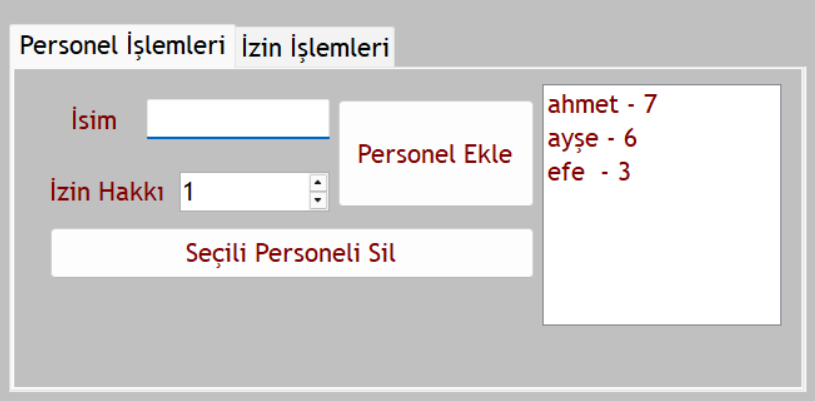

# 📋 Employee & Leave Management System

A **C# Windows Forms** desktop application that allows users to register employees with annual leave entitlements, schedule leave requests by date range, and monitor remaining leave balances in real time.

---

## 🖥️ Application Screenshots

### 1. Employee Management Tab (Add & Remove Staff)
Users enter an employee's name and initial leave allowance (in days) and click **Add Employee (Personel Ekle)** to register them. Registered staff appear in the list on the right alongside their available leave days, and any selected record can be removed via **Delete Selected Employee (Seçili Personeli Sil)**.

  

### 2. Leave Management Tab (Schedule Leave & Balance Deduction)
Users select an employee from the dropdown menu, specify the **Leave Start** and **Leave End** dates, and click **Create Leave (İzin Oluştur)**. The system automatically calculates the requested duration, deducts it from the employee's current allowance, and refreshes the updated balance in the list on the right.

  

---

## ✨ Features

* **Employee Record Management:** Register staff members with initial leave quotas and remove selected records with a single click.
* **Date-Range Leave Calculation:** Automated leave duration computation using start and end date selectors (`DateTimePicker`).
* **Real-Time Leave Balance Tracking:** Automatic deduction of approved leave days and synchronized balance updates across tabs.

---

## 🛠️ Tech Stack

* **Language:** C#
* **UI Framework:** Windows Forms (WinForms)
* **IDE:** Visual Studio
