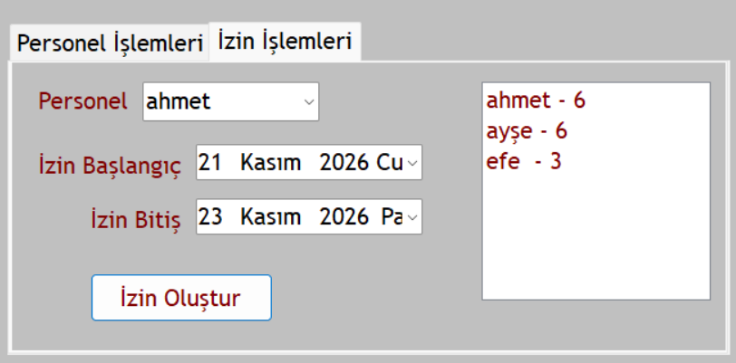

# 📋 Employee & Leave Management System

A **C# Windows Forms** desktop application that allows users to register employees with annual leave entitlements, schedule leave requests by date range, and track remaining leave balances in real time.

---

## 🖥️ Application Screenshots

### 1. Employee Operations Tab (Add & Remove Staff)
Users enter an employee's name and total leave entitlement (in days) and click **Add Employee** (`Personel Ekle`) to register them[cite: 14]. Registered employees and their current leave balances appear in the list on the right, and selected records can be removed at any time via **Delete Selected Employee** (`Seçili Personeli Sil`)[cite: 14].

  

### 2. Leave Operations Tab (Create Leave & Update Balance)
Users select an employee from the dropdown list, specify the **Leave Start** (`İzin Başlangıç`) and **Leave End** (`İzin Bitiş`) dates, and click **Create Leave** (`İzin Oluştur`)[cite: 13]. The system calculates the duration of the selected date range, deducts it from the employee's available leave balance, and immediately updates the list on the right[cite: 13].

  

---

## ✨ Features

* **Employee Record Management:** Register staff members with initial leave entitlements and delete selected records with a single click[cite: 14].
* **Date-Range Leave Calculation:** Automatic calculation of leave duration using start and end date pickers (`DateTimePicker`)[cite: 13].
* **Dynamic Leave Balance Tracking:** Automatic deduction of approved leave days from the employee's remaining balance, synchronized across all tabs[cite: 13, 14].

---

## 🛠️ Tech Stack

* **Language:** C#
* **UI Framework:** Windows Forms (WinForms)
* **IDE:** Visual Studio
